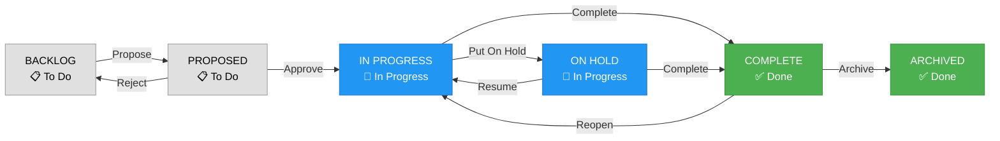
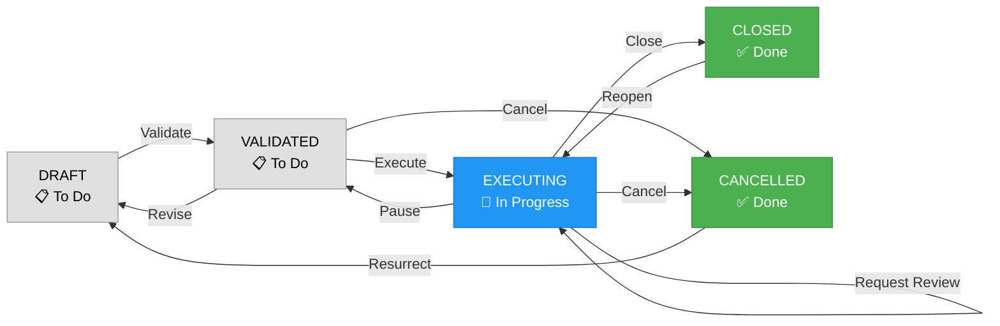
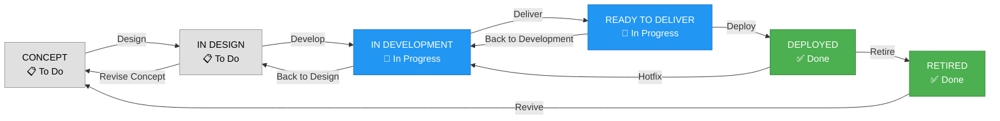
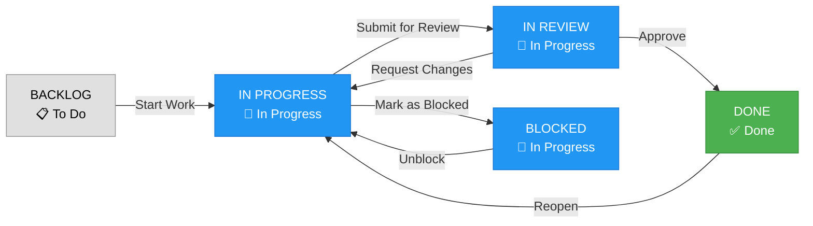

# Jira Issue Type Workflows

## Overview
This document defines the workflow states and transitions for four hierarchical issue types in Jira, from strategic to tactical levels. Each workflow follows Jira's standard state categories:
- **Gray (📋)**: To Do states
- **Blue (🔵)**: In Progress states
- **Green (✅)**: Done states

Transitions are shown as labeled arrows between states.

---

## 1. Value Stream (Strategic Layer)
**Owner:** The Board  
**Main Workflow Path:** Propose → Approve → In Progress → On Hold → Complete → Archive

### States Description
- **BACKLOG**: Initial state for new value streams
- **PROPOSED**: Proposal submitted to the Board
- **IN PROGRESS**: Approved and actively being executed
- **ON HOLD**: Temporarily paused by Board decision
- **COMPLETE**: Value stream objectives achieved
- **ARCHIVED**: Historical record for completed value streams

---

## 2. Initiative (Program Layer)
**Owner:** CEO  
**Main Workflow Path:** Draft → Validate → Execute → Review → Close

### States Description
- **DRAFT**: Initial planning and scoping
- **VALIDATED**: CEO approved and ready for execution
- **EXECUTING**: Active implementation phase (reviews happen during this state)
- **CLOSED**: Initiative completed successfully
- **CANCELLED**: Initiative terminated

### Key Transitions
- **Request Review**: Self-looping transition on EXECUTING that:
  - Creates a review task/subtask
  - Schedules CEO review meeting
  - Doesn't stop execution work
  - Can trigger multiple times (monthly/quarterly reviews)
- **Pause**: If review identifies major issues, can pause execution back to VALIDATED for replanning
- **Close**: Final transition when initiative objectives are met

---

## 3. Product (Game-Level Layer)
**Owner:** VP Product Owner  
**Main Workflow Path:** Concept → Design → Develop → Deliver → Deploy → Retire

### States Description
- **CONCEPT**: Initial product ideation and validation
- **IN DESIGN**: Creating specifications and designs
- **IN DEVELOPMENT**: Building the product
- **READY TO DELIVER**: Development complete, preparing for deployment
- **DEPLOYED**: Live in production
- **RETIRED**: Product end-of-life

---

## 4. Feature (Tactical Layer)
**Owner:** Cross-functional team (Engineering, Art, QA)  
**Main Workflow Path:** Backlog → In Progress → In Review → Done

### States Description
- **BACKLOG**: Prioritized features waiting to be worked on
- **IN PROGRESS**: Actively being developed by the team
- **BLOCKED**: Work stopped due to dependencies
- **IN REVIEW**: Under review by peers or QA
- **DONE**: Feature complete and accepted

---

## Workflow Hierarchy

The four workflows operate at different organizational levels:

1. **Value Stream** (Strategic): Long-term business objectives managed by the Board
2. **Initiative** (Program): Major programs and projects overseen by CEO
3. **Product** (Game-Level): Product development lifecycle managed by VP Product Owner
4. **Feature** (Tactical): Individual features built by cross-functional teams

Each level feeds into the next, with Value Streams containing multiple Initiatives, Initiatives containing multiple Products, and Products containing multiple Features.

---

## Implementation Notes

### Transition Permissions and Rules

1. **Value Stream (Board-Level Transitions)**
   - **Propose**: Any executive can propose, requires business case
   - **Approve**: Board members only
   - **Put On Hold/Resume**: Board decision required
   - **Complete**: Requires metrics/KPIs met
   - **Archive**: Automatic after set period post-completion

2. **Initiative (CEO-Level Transitions)**
   - **Validate**: CEO or delegate approval
   - **Execute**: Triggers resource allocation
   - **Request Review**: Self-looping transition that:
     - Creates a linked review task with due date
     - Assigns to CEO or review committee
     - Captures review notes in initiative comments
     - Can be triggered multiple times (monthly/quarterly)
     - Doesn't change initiative state (work continues)
   - **Pause**: Only after review findings require replanning
   - **Close**: Requires final report and success criteria met

3. **Product (VP Product Owner Transitions)**
   - **Design**: Triggers design team assignment
   - **Develop**: Development team allocation
   - **Deliver**: QA sign-off required
   - **Deploy**: Release management approval
   - **Retire**: Requires migration plan

4. **Feature (Team-Level Transitions)**
   - **Start Work**: Developer self-assigns
   - **Submit for Review**: Automatic PR/MR creation
   - **Approve**: Requires peer review + QA
   - **Mark as Blocked**: Must specify blocking issue

### Self-Looping Transitions Pattern

The "Request Review" pattern on Initiatives can be applied to other workflows:

1. **Value Stream**: Could add "Request Board Update" self-loop on IN PROGRESS
2. **Product**: Could add "Request Stakeholder Feedback" self-loop on IN DEVELOPMENT
3. **Feature**: Could add "Request Clarification" self-loop on IN PROGRESS

These self-looping transitions:
- Don't stop the work
- Generate subtasks or linked issues
- Create audit trail of reviews/feedback
- Allow work to continue in parallel with review activities

### Additional Transitions for Edge Cases

While the main paths are defined above, consider adding these supplementary transitions:

1. **Rollback/Revert Transitions**
   - Products: Deploy → Development (for hotfixes)
   - Features: Done → In Progress (for bugs found post-release)

2. **Cancellation Paths**
   - Add "Cancel" transition from most states to a "Cancelled" end state
   - Useful for abandoned work without completion

3. **Fast-Track Paths**
   - Emergency transitions that skip certain states
   - Requires elevated permissions

### Jira Configuration
1. Create four separate issue types in Jira
2. Configure workflow schemes for each type
3. Map states to appropriate status categories (To Do, In Progress, Done)
4. Set up transition screens and validators as needed
5. Configure permissions based on ownership roles

### Best Practices
- Use automation rules to cascade status changes between hierarchy levels
- Implement required fields at each transition point
- Set up dashboards for each organizational level
- Configure notifications for state changes
- Regular review cycles to ensure workflows remain efficient

---

## Revision History
- Version 1.0: Initial workflow definitions
- Version 2.0: Added comprehensive transitions for edge cases
- Version 3.0: Corrected to show states (rectangles) vs transitions (arrows) properly
- Last Updated: January 2025
- Next Review: Quarterly
